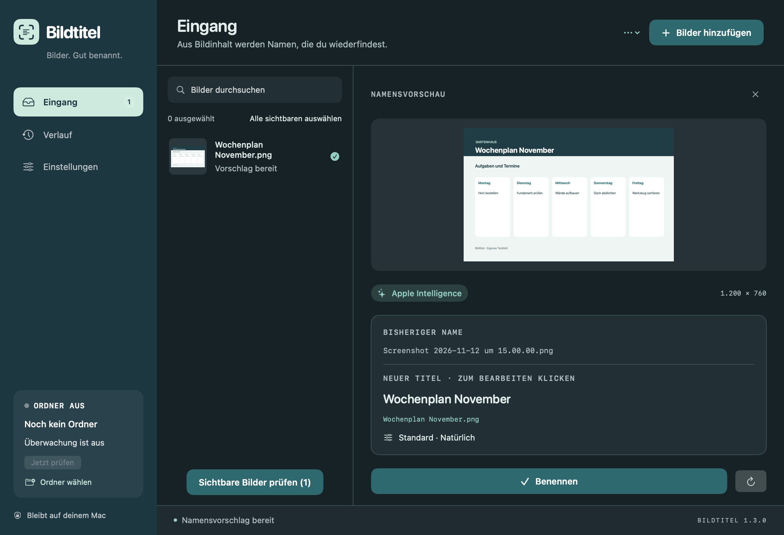

<h1 align="center">Bildtitel</h1>

<strong>Give your screenshots names you can find again.</strong> A native Mac app with on-device Apple Intelligence.

<a href="https://github.com/Nature0ne/Bildtitel/releases/latest"><strong>Download for Mac</strong></a> · <a href="README.md">Deutsch</a>

Bildtitel suggests meaningful filenames from image and screenshot content. Review and edit the suggestion, then rename the file. It can also watch your screenshot folder and name newly arriving screenshots automatically.

- On-device Apple Intelligence, with local OCR fallback.
- Preview, editable titles, batch import and drag and drop.
- Short or detailed names, filename styles and a customizable date prefix or suffix, such as `yy-MM-dd` → `26-11-12`.
- Persistent history and safe undo; existing files are not overwritten.
- Light, dark and system appearance.
- Menu-bar-only mode with an optional Dock icon.
- No account, subscription or external AI API key.

## Install

Download the DMG from the [latest release](https://github.com/Nature0ne/Bildtitel/releases/latest), open it and drag **Bildtitel.app** into **Applications**. A ZIP download is also available. The app is Developer ID signed and notarized by Apple; release assets include SHA-256 checksums.

## Requirements

**Apple Silicon (M1 or later), macOS 26 or later.** The app interface is currently German. AI naming requires Apple Intelligence to be enabled and available on your Mac. On macOS 27+, the local model receives the image as well as extracted text. On macOS 26, naming uses extracted text and image labels. The preview and history identify whether Apple Intelligence or OCR was used.

Bildtitel does not upload your images to an external AI service. Preferences, rename history and a bounded technical diagnostic log are stored locally. The release passed 27 automated tests on macOS 27.2.1, including real on-device AI calls; macOS 26 has not been separately field-tested.

To customize dates, select **Datum davor** (prefix) or **Datum dahinter** (suffix) under **Einstellungen → Namen**, then enter `yy-MM-dd`, `yyyy-MM-dd` or `dd.MM.yyyy` in **Datumsformat**. The preview updates immediately, using your Mac's local time zone.

If folder watching fails, keep Bildtitel running, create a new screenshot and choose **Einstellungen → Diagnose → Diagnose exportieren …**. The JSON export contains technical states, timestamps, counts and error codes; it excludes images, recognized image text, filenames, folder paths and stored access grants. Nothing is uploaded automatically. Version 1.1.1 adds diagnostics; a fix for device-specific watching failures is not yet confirmed.

See the [German guide](README.md) for setup, automatic naming, appearance and menu-bar settings. Report problems or ideas via [Issues](https://github.com/Nature0ne/Bildtitel/issues).

This repository distributes the finished app, product previews and release notes. Product previews are rendered from the app UI with an original sample image.
