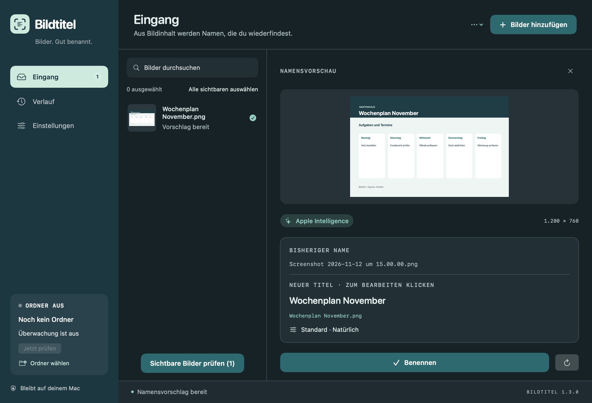
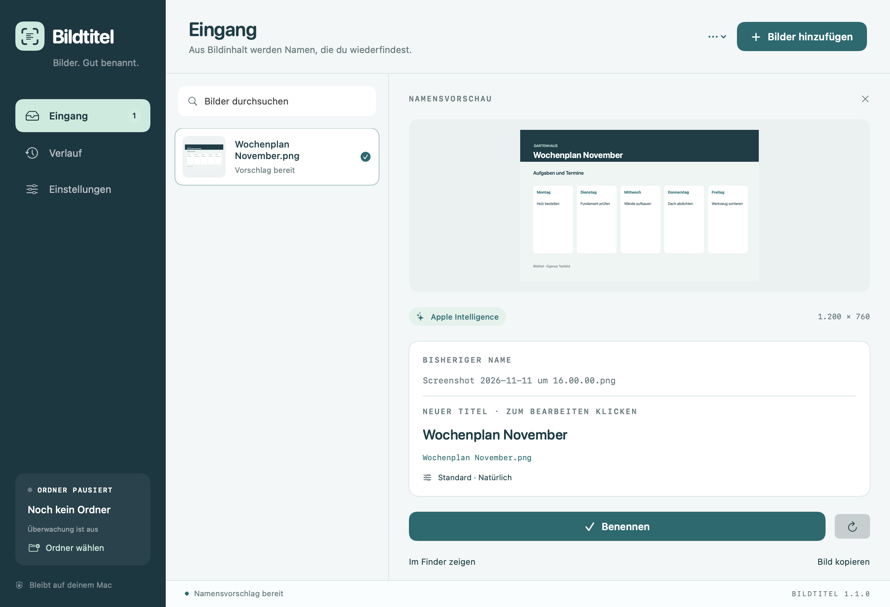

  

<h1 align="center">Bildtitel</h1>

<strong>Bilder. Gut benannt.</strong> Eine native Mac-App, die aus Screenshot-Inhalten verständliche Dateinamen macht.

  <a href="https://github.com/Nature0ne/Bildtitel/releases/latest"><strong>↓ Bildtitel herunterladen</strong></a> ·
  <a href="#installation">Installation</a> ·
  <a href="#apple-intelligence">KI & Datenschutz</a> ·
  <a href="README.en.md">English</a>

macOS 26+ · Apple Silicon · Deutsche Oberfläche · Kostenloser Download

## Aus „Screenshot …“ wird ein Name, der etwas sagt

Screenshots sammeln sich schnell. Bildtitel erkennt ihren Inhalt und schlägt einen passenden Namen vor. Du prüfst ihn, passt ihn bei Bedarf an und benennst die Datei mit einem Klick. Für neue Screenshots kann Bildtitel das auch automatisch im Hintergrund übernehmen.

| Funktion | Das bringt sie dir |
|---|---|
| **Lokale KI** | Apple Intelligence formuliert aussagekräftige Titel auf deinem Mac. |
| **Vorschau vor dem Benennen** | Bild, alter Name und neuer Titel stehen direkt nebeneinander. |
| **Dein Namensstil** | Kurze oder ausführliche Titel, natürliche Schreibweise, Bindestriche, Unterstriche und ein Datum in deinem Format. |
| **Ordnerüberwachung** | Neue Screenshots erscheinen im Eingang oder werden auf Wunsch sofort benannt. |
| **Mehrere Bilder auf einmal** | Bilder per Drag & Drop hinzufügen oder einen vorhandenen Ordner vorbereiten. |
| **Verlauf & Rückgängig** | Bisherige Namen nachvollziehen und wiederherstellen. Vorhandene Dateien werden nicht überschrieben. |
| **Hell, Dunkel oder System** | Die Darstellung passt sich deiner Auswahl an. |
| **Nur in der Menüleiste** | Dock-Symbol ausblenden und Bildtitel über das Statussymbol erreichen. |
| **Updates direkt in der App** | Neue Versionen suchen oder auf Wunsch automatisch laden und beim Beenden installieren. |

<strong>Auch im hellen Design ansehen</strong>

## Installation

1. Lade die **DMG-Datei** aus dem [aktuellen Release](https://github.com/Nature0ne/Bildtitel/releases/latest) herunter.
2. Öffne sie und ziehe **Bildtitel.app** in den Ordner **Programme**.
3. Starte Bildtitel aus Programme.

Alternativ gibt es eine ZIP-Datei: entpacken und die App nach Programme verschieben. Die Downloads sind mit Developer ID signiert und von Apple notarisiert. Prüfsummen stehen als `SHA256SUMS.txt` im Release bereit.

### Die ersten Bilder benennen

- Zieh Bilder ins Fenster oder klicke **Bilder hinzufügen**.
- Prüfe den Vorschlag und bearbeite den Titel bei Bedarf direkt.
- Klicke **Benennen**. Im **Verlauf** kannst du die Umbenennung rückgängig machen.

### Neue Screenshots automatisch benennen

Wähle unter **Einstellungen → Screenshot-Ordner** den Ordner, in dem macOS deine Screenshots ablegt. Aktiviere **Neue Screenshots sofort benennen**, wenn du keine manuelle Bestätigung möchtest. Bestehende Dateien werden beim Start der Überwachung ausgelassen; für ältere Bilder gibt es **Ordner vorbereiten**.

### Dunkelmodus und Menüleistenbetrieb

Unter **Erscheinungsbild** wählst du **System**, **Hell** oder **Dunkel**. Schalte **Im Dock anzeigen** aus, wenn Bildtitel nur als Statussymbol erscheinen soll. Das Fenster öffnest du über **Bildtitel öffnen** oder **Einstellungen …** im Menüleistenmenü. Beim Schließen des Fensters läuft die App weiter.

### Dein Datumsformat

Unter **Einstellungen → Namen** wählst du **Datum davor** oder **Datum dahinter**. Im Feld **Datumsformat** kannst du zum Beispiel `yy-MM-dd` eintragen: Aus dem 12. November 2026 wird dann **26-11-12 Gartenhaus Wochenplan.png**. `dd.MM.yyyy` ergibt **12.11.2026**. Die Vorschau aktualisiert sich sofort; das Datum folgt der lokalen Zeitzone deines Macs.

### Updates ohne erneuten Browser-Download

Ab Version 1.2.0 findest du **Nach Updates suchen …** im Bildtitel-Menü, über das Menüleistensymbol und in den Einstellungen. Die automatische Suche ist standardmäßig aktiv. Unter **Einstellungen → Updates** kannst du zusätzlich **Updates automatisch installieren** einschalten: Neue Versionen werden im Hintergrund geladen und beim Beenden installiert. Ein Neustart wird nicht erzwungen.

Bildtitel verwendet [Sparkle](https://sparkle-project.org/) und prüft die Signaturen des Update-Feeds und der Downloads. Die Suche verbindet sich mit GitHub; Bilder, erkannte Bildtexte und Diagnoseprotokolle werden dabei nicht übertragen. Systemprofiling ist ausgeschaltet.

**Noch Version 1.1.0 installiert?** Lade diese Aktualisierung einmal manuell über GitHub und ersetze die App in Programme. Danach steht die integrierte Updatefunktion zur Verfügung.

## Apple Intelligence

Bildtitel verwendet das lokale Apple-Intelligence-Modell. Dafür muss Apple Intelligence auf deinem Mac aktiviert und das Modell verfügbar sein. Unter macOS 27 und neuer wird auch der Bildinhalt direkt an das lokale Modell übergeben; unter macOS 26 basiert die Benennung auf erkanntem Text und Bildmerkmalen.

Ist die KI nicht verfügbar oder kann sie ein Bild nicht benennen, verwendet Bildtitel lokale Texterkennung. **Welche Methode tatsächlich verwendet wurde, steht in der Vorschau und im Verlauf.** Ein KI-Fehler wird als Rückfall auf Texterkennung kenntlich gemacht.

Kein Konto bei Bildtitel. Kein API-Schlüssel. Kein Abo. Bildtitel lädt deine Bilder nicht zu einem externen KI-Dienst hoch. Einstellungen, Verlauf und ein begrenztes technisches Diagnoseprotokoll werden lokal auf dem Mac gespeichert.

## Voraussetzungen

- **Apple Silicon** – M1 oder neuer. Dieser Download enthält keine Intel-Version.
- **macOS 26 oder neuer**.
- Für KI-Titel: **Apple Intelligence aktiviert und verfügbar**.
- Die Benutzeroberfläche ist derzeit **Deutsch**.

Die Version wurde unter macOS 27.2.1 geprüft, einschließlich echter Apple-Intelligence-Aufrufe, Umbenennen, Rückgängig, Ordnerüberwachung sowie heller und dunkler Darstellung. 27 automatisierte Tests bestanden. Ein separater Praxistest unter macOS 26 steht noch aus.

## Fragen oder einen Fehler gefunden?

Erstelle ein [Issue](https://github.com/Nature0ne/Bildtitel/issues) mit deiner macOS-Version und einer kurzen Beschreibung. Ideen für Verbesserungen sind ebenfalls willkommen.

Falls neue Screenshots nicht im Eingang erscheinen: Lass Bildtitel geöffnet, erstelle einen neuen Screenshot und wähle anschließend **Einstellungen → Diagnose → Diagnose exportieren …**. Den Export findest du auch im Menüleistenmenü. Die JSON-Datei enthält technische Zustände, Zeitpunkte, Dateianzahlen und Fehlercodes – keine Bilder, erkannten Bildtexte, Dateinamen, Ordnerpfade oder gespeicherten Zugriffsrechte. Es wird nichts automatisch hochgeladen. Version 1.2.0 ergänzt diese Diagnose; eine Behebung gerätespezifischer Ausfälle ist damit noch nicht bestätigt.

Dieses Repository enthält die fertigen Downloads, Produktvorschauen und Versionshinweise. Die Vorschauen wurden mit der App-Oberfläche und einem eigens erstellten Beispielbild gerendert.

---

Entwickelt von [Nature0ne](https://github.com/Nature0ne).
