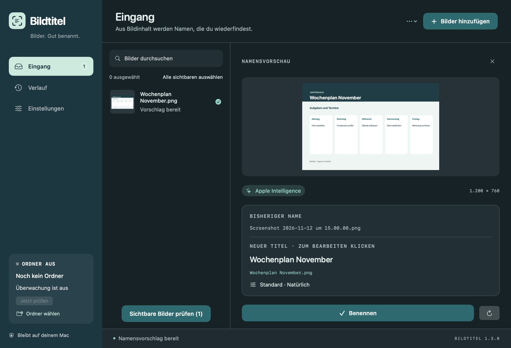
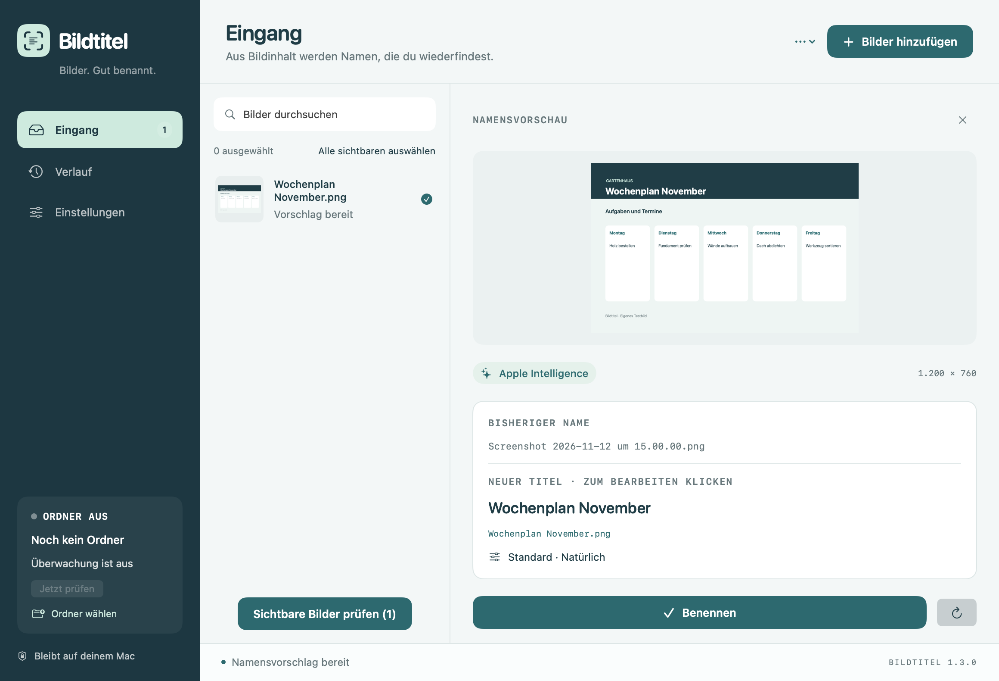

<h1 align="center">Bildtitel</h1>

<strong>Afbeeldingen. Goed benoemd.</strong> Een native Mac-app die de inhoud van schermafbeeldingen omzet in duidelijke bestandsnamen.

  <a href="https://github.com/Nature0ne/Bildtitel/releases/download/v1.3.0/Bildtitel-1.3.0-macOS-AppleSilicon.dmg"><strong>↓ Download Bildtitel 1.3.0</strong></a> ·
  <a href="https://github.com/Nature0ne/Bildtitel/releases/download/v1.3.0/Bildtitel-1.3.0-macOS-AppleSilicon.zip">ZIP</a> ·
  <a href="README.md">Deutsch</a> · <a href="README.en.md">English</a>

macOS 26+ · Apple Silicon · Deutsch · English · Nederlands · Gratis download

## Geef je schermafbeeldingen namen die je terugvindt

Bildtitel herkent de inhoud van een afbeelding en stelt een passende bestandsnaam voor. Bekijk het voorstel, pas de titel zo nodig aan en wijzig de naam met één klik. De app kan ook je map voor schermafbeeldingen bewaken en nieuwe opnamen automatisch van een naam voorzien.

Versie 1.3.0 voegt Engels en Nederlands toe, bewaart je Inbox en biedt naamprofielen en meer controle bij het verwerken van meerdere afbeeldingen.

| Functie | Wat je eraan hebt |
|---|---|
| **Lokale AI** | Apple Intelligence maakt titels op je Mac; lokale tekstherkenning helpt wanneer AI niet beschikbaar is. |
| **Eerst een naamvoorbeeld** | Bekijk de afbeelding, oorspronkelijke naam, bewerkbare titel en volledige bestandsnaam bij elkaar. |
| **Een Inbox die bewaard blijft** | Openstaande voorstellen en bewerkte titels worden lokaal opgeslagen en bij de volgende start hersteld. |
| **Naamprofielen** | Bewaar naamlengte, naamstijl, datumnotatie en de AI-instelling voor verschillende taken. |
| **Gericht meerdere namen wijzigen** | Bekijk zichtbare afbeeldingen of een selectie, bewerk de voorgestelde namen en controleer daarna het resultaat. |
| **Mapbewaking met duidelijke status** | Zie voorbereiding, actieve bewaking, pauzes, fouten en de laatste geslaagde controle; tijdelijke fouten worden opnieuw geprobeerd. |
| **Doorzoekbare geschiedenis** | Zoek op de oorspronkelijke of nieuwe naam en filter op periode, methode of status. |
| **Afbeeldingen van het klembord** | Bewaar een gekopieerde afbeelding als nieuw PNG-bestand en ontvang een naamvoorstel. |
| **Duplicaten herkennen** | Afbeeldingen markeren waarvan de bestandsinhoud gelijk is aan een andere afbeelding in de Inbox of een bekend bestand; niets wordt automatisch verwijderd. |
| **Je eigen datumnotatie** | Plaats de datum vooraan of achteraan, bijvoorbeeld `yy-MM-dd` → `26-11-12`. |
| **Licht, donker of systeem** | Kies je weergave, met beter leesbare aanwijzingen en ruimte voor langere teksten. |
| **Alleen in de menubalk** | Verberg het Dock-pictogram en open Bildtitel weer via het statuspictogram. |
| **Updates in de app** | Zoek naar nieuwe versies of kies voor downloaden op de achtergrond en installeren bij het afsluiten. |

<strong>Bekijk ook de lichte weergave</strong>

## Installeren

Download de **[DMG voor Apple Silicon](https://github.com/Nature0ne/Bildtitel/releases/download/v1.3.0/Bildtitel-1.3.0-macOS-AppleSilicon.dmg)**, open deze en sleep **Bildtitel.app** naar **Apps**. Er is ook een **[ZIP-download](https://github.com/Nature0ne/Bildtitel/releases/download/v1.3.0/Bildtitel-1.3.0-macOS-AppleSilicon.zip)**. De downloads zijn ondertekend met Developer ID en door Apple genotariseerd. SHA-256-controlesommen staan bij de [release](https://github.com/Nature0ne/Bildtitel/releases/tag/v1.3.0).

**Heb je al een oudere versie?** Vanaf 1.2.0 kun je **Zoek naar updates …** gebruiken. Vervang versie 1.1.0 eenmalig handmatig. Rond openstaande voorstellen in deze oudere versies af voordat je bijwerkt: de Inbox wordt daarin nog niet opgeslagen. Bestaande instellingen en de geschiedenis blijven behouden; vanaf 1.3.0 wordt ook de Inbox bewaard.

## Aan de slag

### Eén afbeelding of een selectie hernoemen

Sleep bestanden naar het venster of kies **Afbeeldingen toevoegen**. Bekijk het voorstel, bewerk de titel en klik op **Naam wijzigen**. In **Geschiedenis** kun je de wijziging ongedaan maken. Bestaande bestanden worden niet overschreven.

Selecteer voor meerdere afbeeldingen de gewenste items in de Inbox en kies **Selectie bekijken**. Zonder selectie gebruik je **Zichtbare afbeeldingen bekijken**. De zoekterm en je selectie bepalen welke afbeeldingen worden meegenomen. De voorvertoning toont de voorgestelde namen voordat je begint. Na afloop zie je welke naamswijzigingen zijn geslaagd of mislukt. Mislukte voorstellen blijven in de Inbox.

### Nieuwe schermafbeeldingen bewaken

Kies onder **Instellingen → Map voor schermafbeeldingen** de map waarin macOS je schermafbeeldingen opslaat. Schakel **Namen van nieuwe schermafbeeldingen meteen wijzigen** in als je automatisch wilt hernoemen. Bestanden die al aanwezig zijn wanneer de bewaking start, worden overgeslagen. Gebruik **Map voorbereiden** voor oudere afbeeldingen.

De status maakt onderscheid tussen voorbereiding, actieve bewaking, pauzes en fouten. Je ziet de laatste geslaagde controle en kunt **Nu controleren** kiezen. Bij tijdelijke toegangsproblemen probeert Bildtitel het opnieuw. Afzonderlijke onleesbare bestanden worden overgeslagen en in een melding geteld.

### Voorstellen bewaren en naamprofielen gebruiken

De Inbox en bewerkte voorstellen worden lokaal opgeslagen, zodat je na een herstart verder kunt werken. Herstelde voorstellen worden niet automatisch hernoemd.

Maak onder **Instellingen → Naamprofielen** bijvoorbeeld een profiel voor werk, privé of bonnen. Je kunt profielen toepassen, bijwerken en verwijderen. Je eigen profielnamen en bewerkte titels worden niet vertaald wanneer je de taal van de app wijzigt.

Kies onder **Namen** voor **Datum vooraan** of **Datum achteraan**. `yy-MM-dd` geeft **26-11-12** en `dd.MM.yyyy` geeft **12.11.2026**. Het naamvoorbeeld wordt meteen bijgewerkt en gebruikt de lokale tijdzone van je Mac.

### Klembordafbeeldingen en duplicaten

Kies **Afbeelding van klembord toevoegen** of druk op **⇧⌘V** om een gekopieerde afbeelding toe te voegen. Je kiest zelf waar het nieuwe PNG-bestand wordt bewaard. Bestaande bestanden worden niet overschreven.

Bestanden met identieke inhoud worden als duplicaat gemarkeerd. Toon het origineel in Finder of kies **Toch analyseren** om de afbeelding bewust opnieuw te analyseren. Er wordt niets automatisch verwijderd; gemarkeerde duplicaten worden niet automatisch opnieuw geanalyseerd of hernoemd.

### Geschiedenis, taal en weergave

Zoek in Geschiedenis op de oorspronkelijke of nieuwe bestandsnaam en filter vervolgens op periode, AI/tekstherkenning of verwerkingsstatus.

Bildtitel volgt automatisch je macOS-taalvoorkeuren en ondersteunt **Duits, Engels en Nederlands**. Je kunt een taal voor alleen Bildtitel kiezen onder **Systeeminstellingen → Algemeen → Taal en regio → Apps**. De app houdt ook rekening met de gekozen taal bij het aanvragen van AI-titels. Je eigen titels en bestandsnamen blijven ongewijzigd.

Kies onder **Weergave** voor **Systeem**, **Licht** of **Donker**. Schakel **Toon in Dock** uit om Bildtitel alleen in de menubalk te gebruiken. De app blijft actief wanneer je het venster sluit; je opent het weer via het statuspictogram.

### Updates

**Zoek naar updates …** vind je in het appmenu, het statusmenu en de instellingen. Automatisch zoeken staat standaard aan. Met **Instellingen → Updates → Updates automatisch installeren** worden nieuwe versies op de achtergrond gedownload en bij het afsluiten geïnstalleerd. Opnieuw starten wordt niet afgedwongen.

Updates gebruiken [Sparkle](https://sparkle-project.org/). De handtekeningen van de updatefeed en downloads worden gecontroleerd. Voor updates wordt verbinding gemaakt met GitHub, zonder afbeeldingen, herkende tekst of diagnoselogboeken te versturen. Systeemprofilering staat uit.

## Apple Intelligence en privacy

Voor AI-titels moet Apple Intelligence op je Mac zijn ingeschakeld en moet het model beschikbaar zijn. Vanaf macOS 27 ontvangt het lokale model ook de afbeelding zelf, naast de herkende tekst. Onder macOS 26 gebruikt de naamgeving herkende tekst en afbeeldingskenmerken.

Als AI niet beschikbaar is of geen naam kan voorstellen, gebruikt Bildtitel lokale tekstherkenning. **In het naamvoorbeeld en de geschiedenis zie je welke methode daadwerkelijk is gebruikt.** Na een AI-fout wordt duidelijk vermeld dat tekstherkenning is gebruikt.

Geen Bildtitel-account, API-sleutel of abonnement. Afbeeldingen worden niet naar een externe AI-dienst geüpload. Instellingen, naamprofielen, voorstellen en herkende tekst in de Inbox, de geschiedenis en een begrensd technisch diagnoselogboek worden lokaal op je Mac opgeslagen.

## Vereisten

- **Apple Silicon — M1 of nieuwer.** Deze download bevat geen Intel-versie.
- **macOS 26 of nieuwer.**
- Voor AI-titels: **Apple Intelligence ingeschakeld en beschikbaar**.
- Interface: **Duits, Engels en Nederlands**, automatisch op basis van je macOS-taalvoorkeuren.

67 geautomatiseerde tests zijn geslaagd. De Engelse en Nederlandse interface en handmatige en automatische updates met bewerkte voorstellen in de Inbox zijn gecontroleerd onder macOS 27.2.1. Een afzonderlijke praktijktest onder macOS 26 is nog niet uitgevoerd.

## Vragen of een probleem?

Maak een [Issue](https://github.com/Nature0ne/Bildtitel/issues) met je macOS-versie en een korte beschrijving.

Verschijnen nieuwe schermafbeeldingen niet in de Inbox? Laat Bildtitel open, maak een nieuwe schermafbeelding en kies **Instellingen → Diagnose → Diagnose exporteren …**. Dit kan ook via het statusmenu. Het JSON-bestand bevat technische statussen, tijdstippen, aantallen en foutcodes, maar geen afbeeldingen, herkende tekst, bestandsnamen, mappaden of opgeslagen toegangsrechten. Er wordt niets automatisch geüpload.

Versie 1.3.0 verbetert de bewaking en de bijbehorende meldingen. De oorzaak van de eerder gemelde uitval op een andere Mac is nog niet bevestigd met een diagnose van dat apparaat.

Deze repository bevat de downloads van de app, productvoorbeelden, release-informatie en de ondertekende updatefeed.

---

Ontwikkeld door [Nature0ne](https://github.com/Nature0ne).
